<h1 align="center">Spatial Verification and Action Gating<br>for Vision-Language-Action Policies</h1>

<p align="center">
  
  
  
  
  
  
</p>

<p align="center">
  <b>A check that runs before a robot policy moves.</b> It tests whether the scene matches the instruction (are the named
  objects there, and is the stated spatial relation true?) and stops the robot when it does not.<br>
  The policy is frozen and never changed. No training.
</p>

<p align="center">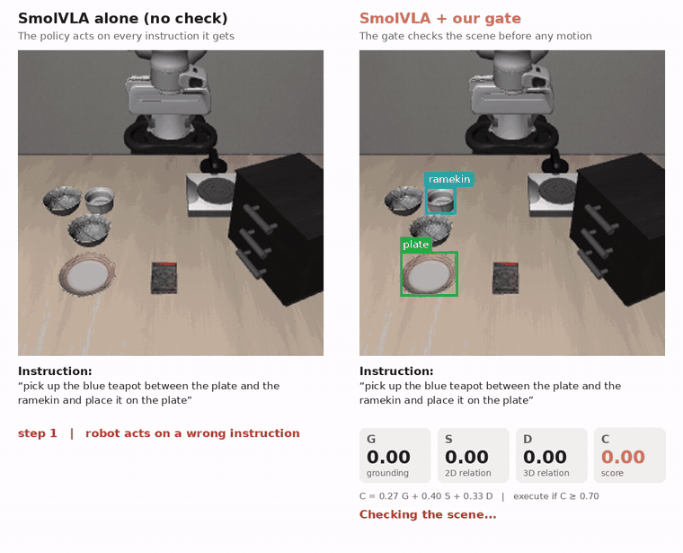</p>
<p align="center"><sub>Same scene, same impossible instruction: there is no blue teapot on the table. Left: SmolVLA alone still moves.
Right: the gate finds no evidence (C = 0.00) and the robot does not move.</sub></p>

<p align="center"><i>Code of the paper "Spatial Evidence-Guided Action Verification and Gating for Vision-Language-Action-Based
Robotic Manipulation" (Aneesh Koti, under review at an IEEE conference).</i></p>

## Highlights

- **Fewer actions on impossible instructions.** SmolVLA alone acted on 100% of them. With the gate in front, the robot acted on
  12.2% (first gate, 90 test cases) and 5.3% (hybrid gate, 150 fresh scenes). All settings were frozen before testing.
- **Training-free and policy-independent.** The same gate works in front of SmolVLA and X-VLA without touching either policy.
- **Each evidence term counts.** Impossible instructions acted on: 58.9% with grounding alone, 18.9% with the 2D relation added,
  12.2% with the 3D relation added.
- **The cost, stated plainly.** About half of the valid instructions are refused, mostly because of grounding errors.
- **Reproducible.** `scripts/reproduce_numbers.py` recomputes the paper's numbers from the saved logs in seconds, without a GPU.

<!-- gallery:start -->
## Robot clips

Real LIBERO-Spatial episodes. First the gate checks the scene (boxes: target red, reference cyan, goal green); only after EXECUTE does the policy move. Recorded with `scripts/make_gifs.py`.

<table>
<tr>
<td align="center" width="33%">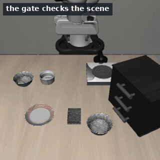<br><sub><b>Correct instruction</b><br><i>“pick up the black bowl next to the ramekin and place it on the plate”</i><br>C = 1.00 → <b>EXECUTE</b>, then SmolVLA completes the task.</sub></td>
<td align="center" width="33%">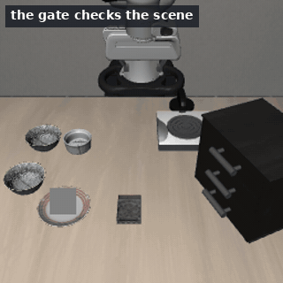<br><sub><b>Valid, part of the scene covered</b><br><i>“pick up the black bowl next to the plate and place it on the plate”</i><br>C = 0.97 → <b>EXECUTE</b>, then SmolVLA completes the task.</sub></td>
<td align="center" width="33%">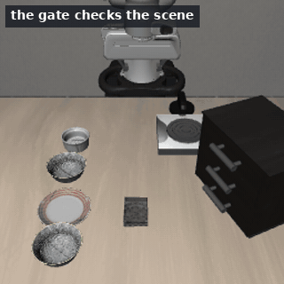<br><sub><b>Valid, extra bowl added, X-VLA</b><br><i>“pick up the black bowl between the plate and the ramekin and place it on the plate”</i><br>C = 1.00 → <b>EXECUTE</b>, then X-VLA completes the task.</sub></td>
</tr>
<tr>
<td align="center" width="33%">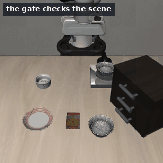<br><sub><b>Impossible: the reference is not on the table</b><br><i>“pick up the black bowl next to the blue teapot and place it on the plate”</i><br>C = 0.00 → <b>STOP</b>: the robot does not move.</sub></td>
<td align="center" width="33%"><br><sub><b>Impossible: the bowl was moved away</b><br><i>“pick up the black bowl next to the ramekin and place it on the plate”</i><br>C = 0.25 → <b>STOP</b>: the robot does not move.</sub></td>
<td align="center" width="33%">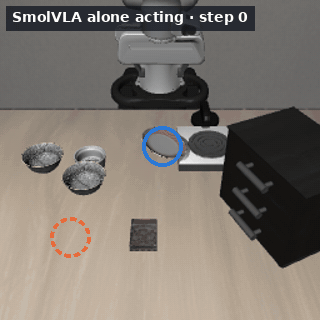<br><sub><b>Limitation: the plate was moved</b><br><i>“pick up the black bowl between the plate and the ramekin and place it on the plate”</i><br>SmolVLA alone carries the bowl to where the plate used to be (orange, 2 cm away) instead of the plate (blue, 37 cm). A check before motion cannot see this.</sub></td>
</tr>
</table>
<!-- gallery:end -->

## The problem

Vision-language-action (VLA) policies such as SmolVLA map a camera image and an instruction directly to robot actions. They have
no way to refuse. If the instruction names an object that is not on the table, or describes a relation that is false, the policy
still produces its most plausible motion. In our tests SmolVLA acted on all 90 impossible LIBERO-Spatial instructions it was given.

## How the gate works

<p align="center">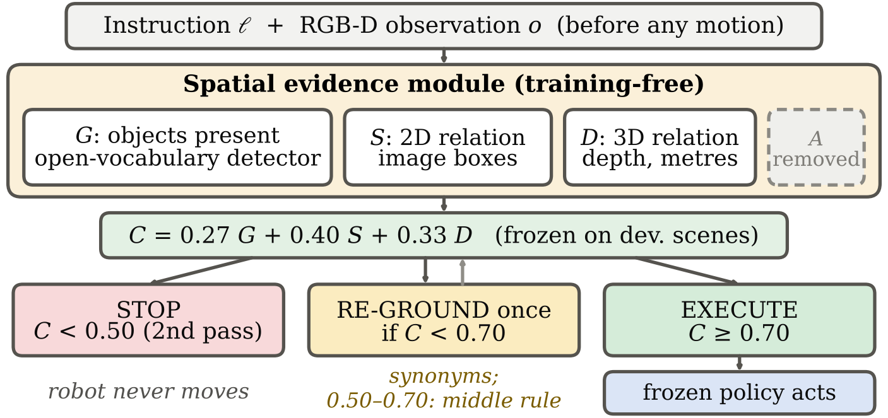</p>

For each instruction, before any motion:

1. **Parse** the instruction into a target ("black bowl"), one or two references ("the plate and the ramekin"), a relation
   ("between") and a goal ("the plate").
2. **G, grounding.** Find the named objects with an open-vocabulary detector. Every bowl candidate is paired with every reference
   candidate, because LIBERO-Spatial scenes contain two identical black bowls and only the relation tells them apart.
3. **S, 2D relation.** Test the relation on the image boxes (graded, from 0 to 1).
4. **D, 3D relation.** Lift the boxes to metric 3D with the depth image and test the relation again, in metres.
5. **Decide.** C = 0.27 G + 0.40 S + 0.33 D. Execute if C ≥ 0.70. Otherwise ground once more with synonyms; stop if C < 0.50;
   in between, execute only if the relation holds in both 2D and 3D and the target bowl is not ambiguous.

The weights, thresholds and confidence ramp were chosen on development scenes only and frozen, with a hash, before any test scene
was run ([configs/](configs)). Two versions of the gate were tested:

* **First gate** (Study 1): Grounding DINO for every object.
* **Hybrid gate** (Study 2): OWLv2 for the bowls, the ramekin and the plate; Grounding DINO for the cabinet, the stove and the
  cookie box. Weights and thresholds unchanged.

## Results

LIBERO-Spatial, 10 tasks, simulated Franka arm. Seven test conditions: three make the instruction impossible (absent reference,
absent target, violated relation) and four keep it valid (nominal, extra distractor bowl, moved plate, occlusion).

| Checker in front of SmolVLA | Impossible instructions acted on (IER, lower is better) | Valid instructions accepted (VAR) |
|---|:---:|:---:|
| none (SmolVLA alone) | 100% | 100% |
| ***Study 1**, 210 test cases (90 impossible, 120 valid)* | | |
| random checker, same acceptance rate | 43.2% | 43.4% |
| detector-confidence checker (tuned on development) | 27.8% | 56.7% |
| first gate (G + S + D) | **12.2%** (11 of 90) | 43.3% |
| ***Study 2**, 350 fresh scenes (150 impossible, 200 valid)* | | |
| VLM judge (Qwen2.5-VL 3B, same image and instruction) | 23.3% | 69.5% |
| first gate | 12.0% | 42.0% |
| hybrid gate | **5.3%** (8 of 150) | 52.5% |

<p align="center">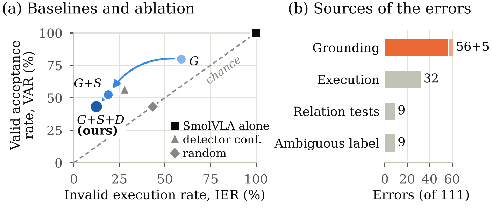</p>
<p align="center"><sub><b>Study 1.</b> (a) Adding the 2D (S) and 3D (D) relation tests lowers the share of impossible instructions
acted on; the random and detector-confidence checkers act on more of them. (b) Where the 111 remaining errors come from:
grounding dominates.</sub></p>

<p align="center">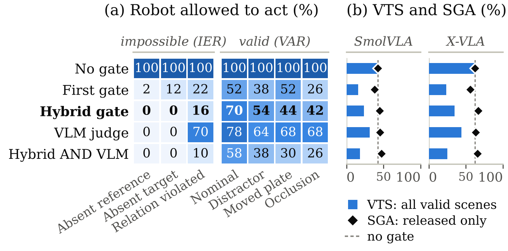</p>
<p align="center"><sub><b>Study 2, 350 fresh scenes.</b> (a) How often each checker let the robot act, per condition (impossible
instructions should be at 0, valid ones at 100). (b) Valid-task success (bars) and success when released (diamonds) behind each
checker, for SmolVLA and X-VLA.</sub></p>

* **A second policy.** The gate's decision does not depend on the policy. Valid-task success is 23.5% (SmolVLA) and 35.0%
  (X-VLA) behind the hybrid gate, against 42.5% and 62.5% without a gate; refused valid instructions count as failures.
* **Attached to the robot.** Run live on 70 scenes per system, the gate gave the same decision as the separate sweep in 69 of 70.
* **Time.** About 2.7 s per scene for the hybrid gate on a laptop GPU (RTX 5050, 8 GB).

### Why a hybrid detector

<p align="center">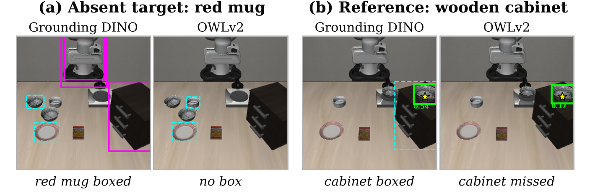</p>
<p align="center"><sub>(a) Grounding DINO boxes a red mug that is not on the table; OWLv2 does not. (b) OWLv2 misses the wooden
cabinet, which Grounding DINO finds. The hybrid gate routes each object to the detector that handles it.</sub></p>

### Limitations

The price is false refusals: about half of the valid instructions are refused, mostly because of grounding errors (for example,
the detector selects the wrong one of the two identical bowls). The gate reduces the execution of instructions that do not match
the scene; it does not make the policy more successful on the instructions it lets through. Failures that appear only during
execution are invisible to a check made before motion: when the plate is moved, SmolVLA still carries the bowl to where the plate
used to be. Everything is in simulation.

<p align="center">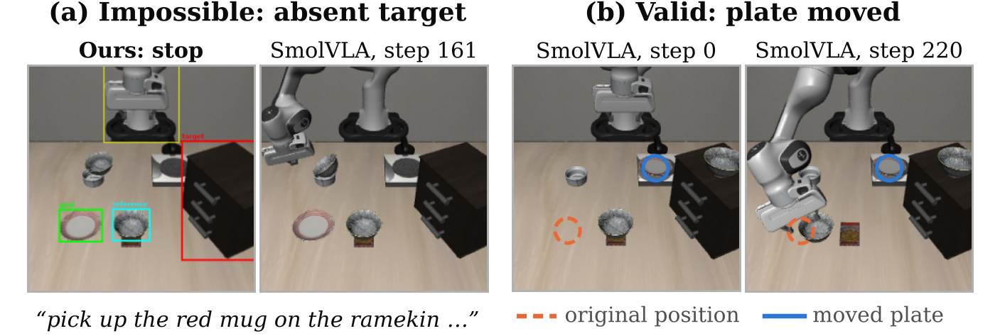</p>
<p align="center"><sub>(a) The gate stops an impossible instruction that SmolVLA alone acts on. (b) A failure a pre-action check
cannot see: with the plate moved, SmolVLA lowers the bowl at the plate's original, now empty, position.</sub></p>

## Repository

```
vla_gate/                 the method as a small Python package
  gate.py                 SpatialGate: grounding -> G, S, D -> C -> EXECUTE or STOP
  evidence.py             grounding of the named objects and the evidence G, S, D
  relations.py            graded spatial relations in 2D (pixels) and 3D (metres)
  detectors.py            Grounding DINO, OWLv2 and the hybrid detector
  decision.py             the decision rule (also recomputes every decision from the result files)
  geometry.py             camera model, depth, box helpers
  parsing.py              instruction parser
  sim.py                  LIBERO-Spatial scenes and the seven test conditions
  policies.py             SmolVLA and X-VLA rollouts
configs/                  the frozen settings of Study 1 and Study 2
notebooks/00_quickstart.ipynb    the gate on one scene, in a few minutes
experiments/              the exact code behind every table of the paper (see experiments/README.md)
scripts/
  reproduce_numbers.py    recomputes the paper's numbers from the saved results, in seconds
  collect_results.py      copies the result tables of a run into results/
  make_gifs.py            records the robot clips of this page
results/                  result tables of our runs (CSV and JSON)
tests/                    checks that vla_gate gives exactly the same answers as the experiment code
assets/                   figures, the demo and the robot clips
```

## Installation

LIBERO needs Linux (we used Ubuntu under WSL2 on Windows) and an NVIDIA GPU; 8 GB of GPU memory is enough.

```bash
git clone https://github.com/aneeshkoti/vla-spatial-verification.git
cd vla-spatial-verification
conda create -n vlagate python=3.12 -y
conda activate vlagate
pip install -r requirements.txt
```

We used Python 3.12, PyTorch 2.11 (CUDA 12.8), LeRobot 0.6.2 (installed from source; the PyPI release 0.6.1 in
`requirements.txt` contains every LeRobot module this code uses) and MuJoCo 3.8.1. The models are downloaded from Hugging Face on
first use: `IDEA-Research/grounding-dino-base`, `google/owlv2-base-patch16-ensemble`, `HuggingFaceVLA/smolvla_libero`,
`lerobot/xvla-libero` and, for the VLM judge only, `unsloth/Qwen2.5-VL-3B-Instruct-bnb-4bit`.

## Quick start

Open [notebooks/00_quickstart.ipynb](notebooks/00_quickstart.ipynb) and run all cells. Or in Python:

```python
from vla_gate import SpatialGate
from vla_gate.sim import make_env, make_case

gate = SpatialGate.load("hybrid")                   # OWLv2 + Grounding DINO with the frozen settings
env, task, instruction = make_env(0)                # LIBERO-Spatial task 0
obs, instr = make_case(env, task_id=0, state=5, kind="absent_target")
print(instr)    # pick up the blue teapot between the plate and the ramekin and place it on the plate
print(gate.check_libero(env, obs, instr))
# G = 0.00 | S = 0.00 | D = 0.00 | C = 0.00 (after re-grounding) -> STOP (the robot does not move)
```

For another robot or camera, call `gate.check(image, depth, camera, instruction)` with a PIL image, a depth map in metres and a
`vla_gate.CameraModel(K, cam2world, flips=(False, False))`.

## Reproducing the paper

**From the saved results (seconds, no GPU).** With the result tables in `results/`:

```bash
python scripts/reproduce_numbers.py
```

Every decision is recomputed from the logged evidence with the frozen settings, and each number is printed next to the value in
the paper.

**Running the experiments again (GPU, hours).** The notebooks in [experiments/](experiments) contain the code exactly as it was
run, in the order it was run. Long cells are resumable: they append to a CSV file and skip cases that are already saved.

| Notebook | Paper | GPU time |
|---|---|---|
| `01_study1_first_gate.ipynb` | Section IV, Tables II and III | about 12 h |
| `02_study2_hybrid_gate.ipynb` | Sections V-A, V-B, V-E, Tables IV and V | about 9 h |
| `03_second_policy_and_vlm_judge.ipynb` | Sections V-B, V-C, Tables V and VI | about 4 h |
| `04_attached_run_and_demo.ipynb` | Section V-D, Table VII, demo video | about 2 h |
| `05_detector_comparison.ipynb` | Section V-A, Fig. 4 (four detectors outside the gate) | about 40 min |

**Checks.** `python tests/test_equivalence.py` runs the `vla_gate` package and the experiment code side by side on synthetic
scenes and confirms they give the same evidence values, boxes and decisions (2,400 gate checks, no models needed).

## Citation

The paper is under review. A citation will be added here after the review.

## Acknowledgements

This work builds on [LIBERO](https://github.com/Lifelong-Robot-Learning/LIBERO), [LeRobot](https://github.com/huggingface/lerobot),
SmolVLA, X-VLA, Grounding DINO, OWLv2 and Qwen2.5-VL.

Contact: Aneesh Koti, aneeshkoti@gmail.com
